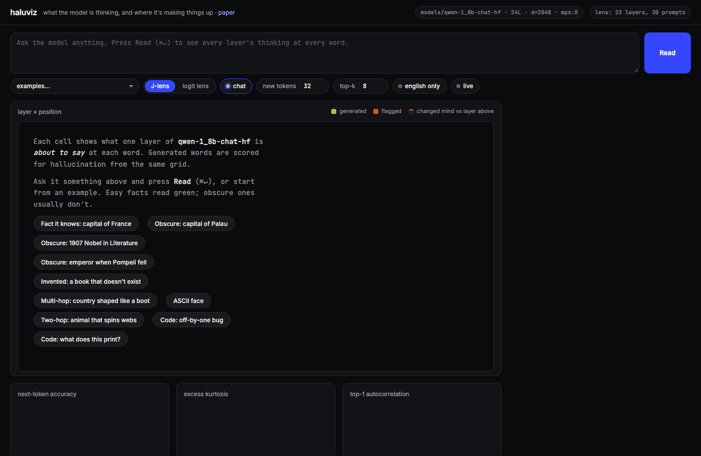
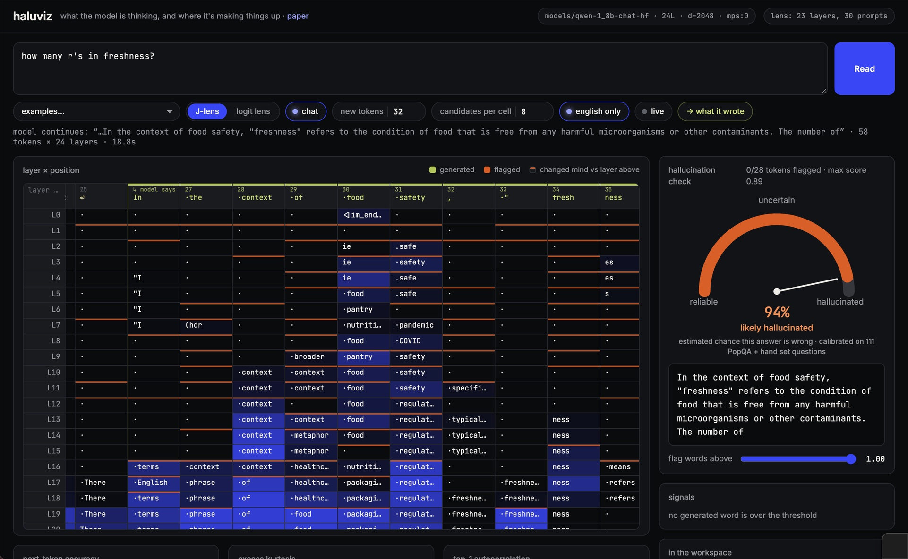

# haluviz

**Watch a small language model think, layer by layer, and catch it making things up.**

haluviz runs Qwen-1.8B-Chat, a small open model from 2023 that gets a lot of
facts wrong. For every word it writes, you can see what each of its 24 layers
wanted to say, how sure it was, and whether the answer was ever in its
"working memory" before it came out. From those signals it estimates how
likely the answer is to be wrong, and a stronger model can then check the
truth and suggest a better answer.


The layer-reading method is the **Jacobian lens** from Anthropic's
[global workspace paper](https://transformer-circuits.pub/2026/workspace/index.html).
The visualizer started from [Festyve/jspace-viz](https://github.com/Festyve/jspace-viz).

## What's on the screen

- **The grid.** One column per word, one row per layer. Each cell is the word
  that layer was leaning toward. Brighter blue means more confident. Green
  columns are the words the model actually wrote. Orange means a word was
  flagged. A thin orange line on top of a cell means the model changed its
  mind at that layer.
- **Hallucination check.** A gauge from *reliable* to *hallucinated* and a
  percentage: the chance this answer is wrong, measured on real answers (see
  *How good is it*). Below it, the answer with suspicious words marked.
- **Signals.** For each flagged word: how confident the model was, how late
  it decided, whether the word was in its working memory beforehand, and how
  much it wavered at the end.
- **In the workspace.** The ideas the model was holding in its middle layers
  while answering. Chinese tokens get an English gloss.
- **Fix.** *Verify answer* asks Gemini if the answer is true. *Suggest a fix*
  offers a safer "I'm not sure" answer and the corrected one.

The **J-lens / logit lens** switch changes how the middle layers are read.
The logit lens shows them raw, which is mostly noise. The J-lens shows what
they are *about to become*, which is readable.

## Run it

You need a Mac with Apple Silicon (8 GB is enough) or a Linux machine with a
GPU, plus [`uv`](https://docs.astral.sh/uv/) and about 8 GB of free disk.

1. **Install**
   ```sh
   git clone https://github.com/lostfilesofanni/haluviz && cd haluviz
   uv venv --python 3.12 && uv pip install -e '.[fit]'
   ```
2. **Download and convert the model** (once, about 5 minutes)
   ```sh
   .venv/bin/python scripts/convert_gguf_to_hf.py
   ```
   The last line must say `self-check answer: The capital of France is Paris.`
3. **Optional, for the Verify button:** create a file called `.env` in the
   project folder with one line: `GEMINI_API_KEY=your-key`. It is never
   committed.
4. **Optional, for the J-lens:** download `qwen-1_8b-chat_jlens_wikitext.pt`
   from the Releases page into a folder called `lenses/`. Or make your own on
   a free GPU with `colab/fit_lens_colab.ipynb`, about 45 minutes. Without it
   the app still works, in logit-lens mode.
5. **Start**
   ```sh
   .venv/bin/haluviz
   ```
   Open <http://127.0.0.1:8321>, pick an example or type a question, press
   **Read**.

Good to know:

- The first read of a question takes about 30 seconds on an M1. Set *new
  tokens* to 16 for short answers and it halves. Reading the same question
  again, for example after switching lens, takes a few seconds.
- The app uses about 2.4 GB of memory while running and shuts itself down
  after 10 idle minutes.



## How the detection works

Every generated word gets a score between 0 and 1 from three things read off
the grid: how **confident** the output layer was, how **late** in the network
the word was decided, and whether it was **in the workspace** of the middle
layers before being said. A fourth signal, how much the prediction
**wavered** in the last layers, is shown but not yet part of the score.

The score of the whole answer is turned into a percentage using a table
measured on 111 real answers whose truth was checked by Gemini. The detector
only sees the inside of the model, so it catches *guessing*. When the model
is confidently wrong, it looks the same as knowing; that is what the Verify
button is for.

Two things it shows well:

- **A made-up fact.** "What is the capital city of Palau?" → *Nha Trang*,
  which is in Vietnam. The J-lens column for that word reads, from the middle
  layers down, *city → island, archipelago → Koror*; "Nha" shows up only at
  the very end with no support.
- **Answering the wrong question.** "How many r's in freshness?" → a
  definition of food freshness. The workspace shows the food-safety ideas that
  took over.



## How good is it

Tested on 111 answers, 82 of them wrong according to Gemini. Ranking answers
by the detector's score puts wrong ones above right ones 90 % of the time
(AUROC 0.90). Scores under 0.70 were wrong 8 % of the time; scores over 0.85
were wrong every time.

The J-lens makes the grid readable but does not catch more hallucinations
than the confidence signal alone on this model (0.87 vs 0.90). The
experimental re-decode in *Suggest a fix* changes wording but does not
repair facts the model never knew; abstaining and verifying do work.

Everything, including the numbers and why each decision was made, is in
[`docs/IMPLEMENTATION.md`](docs/IMPLEMENTATION.md).

To rerun the evaluation yourself, start the app and then:

```sh
.venv/bin/python scripts/eval_detector.py --url http://127.0.0.1:8321   # 30 hand-picked questions
.venv/bin/python scripts/eval_popqa.py --url http://127.0.0.1:8321 --n 100   # 100 PopQA questions
```

## Limits

- The model is tiny and old; it gets 88 % of obscure facts wrong and cannot
  count letters at all, because it sees word pieces, not letters.
- The detector cannot see confident errors.
- The lens was fitted on 30 texts instead of the paper's 1000.
- Gemini is the judge of truth, and it is not perfect either.

## Credits

`jspace_viz/` is based on [Festyve/jspace-viz](https://github.com/Festyve/jspace-viz)
(Apache-2.0). Lens method from
[anthropics/jacobian-lens](https://github.com/anthropics/jacobian-lens).
License: Apache-2.0.
