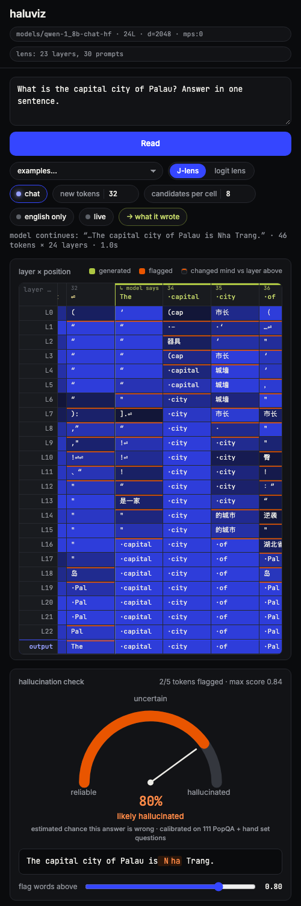
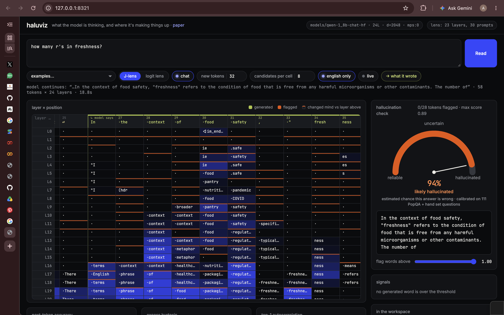

# haluviz

**See what a language model is thinking at every layer, and catch it making things up.**

haluviz runs the original **Qwen-1.8B-Chat** (2023), shows what each of its 24
layers is about to say at every word, scores every generated word for
hallucination from those same internals, and turns the score into a
calibrated *"estimated chance this answer is wrong"*. A stronger model can then
verify the answer and suggest a fix.


It is built on the **Jacobian lens** from Anthropic's
[*Verbalizable Representations Form a Global Workspace in Language Models*](https://transformer-circuits.pub/2026/workspace/index.html)
and on [Festyve/jspace-viz](https://github.com/Festyve/jspace-viz) (Apache-2.0),
which is vendored and extended here.

---

## What you see

| panel | meaning |
|---|---|
| **layer × position grid** | one column per word, one row per layer. Each cell is the word that layer is leaning toward; blue intensity is confidence. Green columns are the model's own generated words. An orange header means that word was flagged. An orange top edge on a cell means the layer above disagreed, so the model changed its mind there. |
| **hallucination check** | a gauge from *reliable* to *hallucinated* with the calibrated chance the answer is wrong, the answer with suspicious words marked, and a slider for how strict the word-level flags are. The gauge does not depend on the slider. |
| **signals** | for every flagged word: the model's confidence in it, how deep in the network it was decided, whether it was in the mid-layer workspace beforehand, and how unstable the prediction was in the last layers. |
| **in the workspace** | concepts active in the middle layers that are neither in the prompt nor the literal next word: the model's working memory, with English glosses for non-English tokens. |
| **fix** | **Verify answer** asks Gemini whether the answer is true and what the truth is. **Suggest a fix** shows a safer abstaining answer, the verified correction, and an experimental layer-contrast re-decode. |

Two lenses are available with the segmented control. **Logit lens** reads each
layer's state directly and is noise in the early layers. **J-lens** reads it
through a fitted matrix that accounts for what the remaining layers will do,
so the middle of the network becomes readable (see *Results*).

Before the first read, the right column explains the flow:


---

## Quick start

Tested on an Apple-Silicon Mac with 8 GB of RAM; Linux with a GPU works too.
You need [`uv`](https://docs.astral.sh/uv/) and about 8 GB of free disk.

**1. Install**

```sh
git clone https://github.com/lostfilesofanni/haluviz && cd haluviz
uv venv --python 3.12 && uv pip install -e '.[fit]'
```

**2. Get the model.** One time, about 5 minutes: downloads the 3.7 GB
community GGUF and converts it into a native Transformers checkpoint under
`models/`.

```sh
.venv/bin/python scripts/convert_gguf_to_hf.py
```

It must end with `self-check answer: The capital of France is Paris.`

**3. Optional: the verifier.** Create a file named `.env` in the project
folder containing one line. It is git-ignored.

```
GEMINI_API_KEY=your-key
```

**4. Optional: the J-lens.** Either download `qwen-1_8b-chat_jlens_wikitext.pt`
from this repo's Releases page into `lenses/`, or fit your own on a free GPU
with `colab/fit_lens_colab.ipynb` (Google Colab) or
`colab/fit_lens_kaggle.ipynb` (Kaggle), about 45 minutes. Without it the app
runs in logit-lens mode.

**5. Run**

```sh
.venv/bin/haluviz
```

Open <http://127.0.0.1:8321>, pick an example or type a factual question,
press **Read**.

- The first read of a question takes about 30 s on an M1; generation
  dominates, so set *new tokens* to 16 for one-sentence answers.
- Re-reads of the same question, for example after switching lens or
  pinning a word, reuse the cached answer and take a few seconds.
- The server holds about 2.4 GB of memory while it runs and exits by itself
  after 10 idle minutes (`--idle-timeout 0` disables that). Run only one
  model-loading process at a time on an 8 GB machine.

The layout works on narrow screens too; the cards stack in reading order.



---

## How the detector works

For each generated word, four signals are read off the column that produced it:

| signal | question it answers |
|---|---|
| **confidence** (`p_final`) | how sure the output layer was of the word it chose |
| **decided at** (`commit_depth`) | how deep in the network the word became, and stayed, the top choice; 100 % means only at the very end |
| **in workspace** (`support`) | the best probability the word had in the middle layers before being spoken |
| **instability** | how much the prediction kept changing across the last third of the layers (shown, not yet scored) |

`score = mean(1 − confidence, decided-at, 1 − in-workspace)`. Punctuation
and words copied from the prompt are never flagged, and flags apply to whole
words. The answer-level risk is `(max + mean) / 2` of the word scores, mapped
through a calibration table measured on real answers (below).

The detector reads only the model's internals, so it catches *guessing*. A
confident false belief looks like knowledge from the inside; that is what
the verifier is for.

### Two kinds of failure it shows

**Fabricated fact.** *"What is the capital city of Palau?"* → *Nha Trang* (a
city in Vietnam). The word is flagged, the gauge reads 80 %, and the J-lens
column that produced it shows the model was thinking *city → island,
archipelago → Koror* before "Nha" appeared with no support anywhere.

**Task drift.** *"How many r's in freshness?"* → a definition of food
freshness. The gauge reads 94 %, and the workspace shows the food-safety
cluster (*food, pantry, safety, regulation*) that hijacked the answer. The
counting part of the question never appears.



---

## Results

Labels come from the Gemini judge, not hand labeling. Honest refusals
("I don't have information on…") are excluded.

| evaluation | answers | wrong | AUROC |
|---|---|---|---|
| PopQA, 100 long-tail questions sampled | 81 | 71 (12 % accuracy) | 0.80 |
| hand set, 30 questions | 30 | 11 | 0.92 |
| **pooled, logit lens** | 111 | 82 | **0.90** |
| pooled, J-lens | 111 | 82 | 0.87 |

Calibrated risk shown by the gauge (pooled): answer score < 0.70 → 8 % wrong
· 0.70–0.75 → 36 % · 0.75–0.80 → 75 % · 0.80–0.85 → 91 % · ≥ 0.85 → 100 %.

**What the J-lens changes.** It does not detect more hallucinations than
output confidence on this model, but it makes them legible: the two
workspace signals stay near chance at the question level under both lenses,
while the per-layer readout becomes meaningful instead of noise.

**What the fixes do.** Abstention and the verified correction work. The
DoLa-style re-decode changes wording but does not repair facts the model
never had; it is kept, labelled experimental, as a measured negative result.

Full method, numbers, and the decisions log: [`docs/IMPLEMENTATION.md`](docs/IMPLEMENTATION.md).

---

## Evaluate it yourself

All evaluations talk to a running server, so start `haluviz` first.

```sh
.venv/bin/python scripts/eval_detector.py --url http://127.0.0.1:8321          # hand set (data/questions.json)
.venv/bin/python scripts/eval_popqa.py    --url http://127.0.0.1:8321 --n 100  # PopQA + calibration table
.venv/bin/python scripts/judge_labels.py  data/popqa_results.json              # re-label with the Gemini judge
.venv/bin/python scripts/eval_fix.py      --url http://127.0.0.1:8321          # greedy vs DoLa re-decode
```

Add your own questions to `data/questions.json` as
`{"q": "...", "answers": ["accepted", "aliases"]}`. Re-running
`eval_popqa.py` rewrites `data/calibration.json`, which the gauge reads live.

---

## Limitations

- The model is deliberately weak: 2023, 1.8 B parameters, wrong on 88 % of
  long-tail facts. Letter-counting questions are unwinnable for it because it
  never sees letters, only word pieces.
- Confident errors are invisible to the detector by construction.
- The lens was fitted on 30 prompts, where the paper uses 1000. 111 labeled
  questions is enough to show the effect, not to tune a learned combination.
- Gemini is the ground truth for labels and verification, with its own error
  rate. It agreed with simple alias matching on 70 of 81 PopQA answers and
  was right on inspection where they disagreed.
- Speed is bounded by memory on an 8 GB laptop, not by the code.

---

## Project layout

```
jspace_viz/              server, int8 model loading, lens, grid readout, detector, verifier, fixes, static UI
scripts/                 convert_gguf_to_hf.py · fit_lens.py · eval_detector.py · eval_popqa.py · judge_labels.py · eval_fix.py
colab/                   notebooks that fit the J-lens on a free GPU (Colab, Kaggle)
data/                    question sets, evaluation results, calibration tables
docs/IMPLEMENTATION.md   the full write-up
docs/img/                screenshots
models/  lenses/         created locally; git-ignored
```

## Credits and license

`jspace_viz/` is vendored from [Festyve/jspace-viz](https://github.com/Festyve/jspace-viz)
(Apache-2.0, Michael Zhang) with modifications; the lens method follows
[anthropics/jacobian-lens](https://github.com/anthropics/jacobian-lens). See
`NOTICE`. This project is Apache-2.0.
